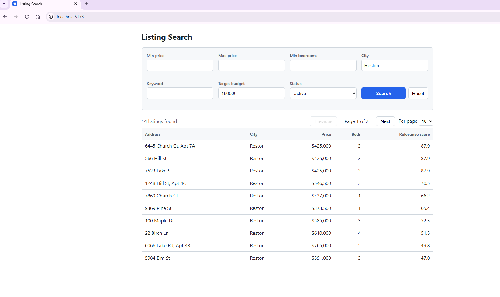
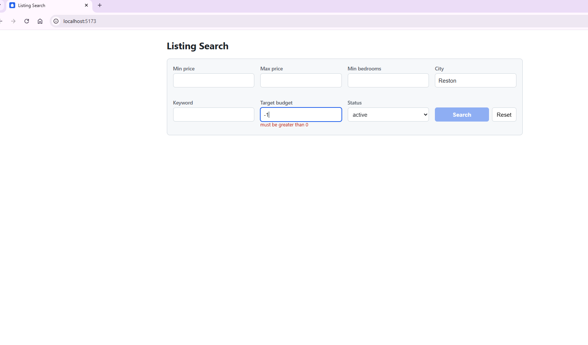

# Listing Search

A small full-stack app that searches real-estate listings, scores them and shows them page by page.
The back end is Java 17 and Spring Boot with JPA and Flyway. It runs on an in-memory H2 database by
default and on Oracle with a profile. The front end is React and TypeScript.




## What you need

- Java 17
- Node (developed on v24)
- Nothing else for the default run. Maven is included through the wrapper (`mvnw`), and the H2
  database is in memory.
- Only if you want to run against Oracle: an Oracle database you can reach (I used Oracle Database
  Free on my own machine), and an admin login to run the setup script once. See "Use Oracle instead
  of H2" below.

## Get the code

Clone the repository (or unzip the archive if you received a zip):

    git clone https://github.com/chanderneeti/listing-search.git
    cd listing-search

Open a terminal in the folder that contains `backend` and `frontend`.

## Run it

Commands are for Windows PowerShell. In Command Prompt, drop the `.\` in front of `mvnw.cmd`. On Mac
or Linux use `./mvnw` instead.

**Back end** (http://localhost:8080)

```
cd backend
.\mvnw.cmd spring-boot:run
```

On startup the loader reads two files and inserts the listings: the supplied `sample_listings.json`
(12 rows) and a generated `demo_listings.json` (152 rows), so there is enough data to page through.
The H2 console is at http://localhost:8080/h2-console (JDBC URL `jdbc:h2:mem:listings`, user `sa`,
empty password).

**Front end** (http://localhost:5173)

```
cd frontend
npm install
npm run dev
```

The dev server forwards `/api` to the back end on port 8080, so start the back end first.

**Tests**

```
cd backend
.\mvnw.cmd test

cd frontend
npm test
```

All back-end tests run on in-memory H2, whatever profile is set. The front-end tests cover the form
validation rules (Vitest).

## Use Oracle instead of H2

This needs an Oracle database that is already installed and running. The app does not create one.
The same code and the same Flyway script run on both databases. Only the datasource changes.

1. Connect to your pluggable database as an admin user and run `scripts/oracle-setup.sql`. It creates
   a `listings` user. Put your own password in the script first.
2. Set the password as an environment variable. It is never stored in a file:
   `setx LISTINGS_DB_PASSWORD "your-password"` (then open a new terminal).
3. Check the URL in `backend/src/main/resources/application-oracle.properties`. It assumes
   `localhost:1521/FREEPDB1`. Change the service name if yours is different.
4. Start with the profile:
   `.\mvnw.cmd spring-boot:run "-Dspring-boot.run.profiles=oracle"`

Flyway creates the table on first start. Hibernate only validates it. Restarting is safe, because the
loader adds only the listings that are not already there.

## Data

- `sample_listings.json` is the file that came with the exercise. I did not change it.
- `demo_listings.json` is generated by `node scripts/generate-demo-data.mjs` (run from the project
  root). It uses a fixed seed, so the same file comes out each time. It has 8 cities, all three
  statuses, near-duplicate listings reported by a second feed, "pets allowed" and "no pets" wording,
  and a few groups with identical price and date to exercise tie-breaking. Running it again is
  optional.
- Which files load is set by one property, `listings.data-files`. To load only the sample file:
  `--listings.data-files=classpath:data/sample_listings.json`.
- To add listings, add them to a JSON file and restart. The loader inserts only new rows. It never
  deletes anything, so on Oracle, drop the schema (last line of the setup script) to start clean.

## API

`GET /api/listings/search`

| Parameter | Meaning | Rule |
|---|---|---|
| `minPrice`, `maxPrice` | price range | 0 or more. `minPrice` must not exceed `maxPrice` |
| `minBedrooms` | minimum bedrooms | 0 or more |
| `city` | city name | exact match, ignoring case and surrounding spaces |
| `keyword` | word in the description | whole-word match, ignoring case |
| `targetBudget` | price the user has in mind | greater than 0. Used for scoring only, not as a filter |
| `status` | `active`, `pending` or `sold` | defaults to `active` |
| `page` | page number | 1 or more, default 1 |
| `pageSize` | rows per page | 1 to 50, default 10 |

The response has `items`, `page`, `pageSize`, `totalItems`, `totalPages` and `message`. Each item has
`id`, `source`, `address`, `city`, `state`, `zip`, `price`, `bedrooms`, `bathrooms`, `sqft`,
`listedDate`, `status` and `score`.

The `score` field is the relevance score shown in the results table.

Bad input returns `400` with a ProblemDetail body and an `errors` list of `{field, message}`. A value
that is not a number gives "must be a number". A search with no results returns `200` with an empty
list and a `message`: "No listings in X" if the city does not exist at all, otherwise "No listings
match your search". A page past the last one returns `200`, no items, the right totals and a message.

### Assumptions

- The `id` in a response is the id from the feed. It is only unique together with `source`.
- Blank `city` and `keyword` values mean "no filter".
- `sold` and `pending` listings are left out unless you ask for them, because `status` defaults to
  `active`.
- A listing dated in the future counts as posted today.
- Scores are rounded to two decimals only when the response is built.

## Scoring

Every listing that passes the filters gets a relevance score from 0 to 100. The filters decide which
listings you see. The score only decides the order, best first.

The score has two parts:

- **Price fit** is how close the price is to your target budget. A listing at your target gets 1.
  The further away the price is, the lower it gets, and at twice the target it gets 0. It is
  measured against the target, so being $20,000 away matters more on a $200,000 budget than on a
  $1,000,000 one.
- **Freshness** is how recently the listing was posted. Posted today gets 1. The value halves every
  45 days, so a listing that is 45 days old gets 0.5 and one that is 90 days old gets 0.25.

If you give a target budget, the score is 60% price fit and 40% freshness. If you don't, there is
nothing to compare the price with, so the score is freshness only.

    score     = 100 x (0.6 x priceFit + 0.4 x freshness)
    priceFit  = max(0, 1 - |price - target| / target)
    freshness = 0.5 ^ (ageInDays / 45)

Example with a target of $400,000:

| Listing | Price    | Posted      | Price fit | Freshness | Score |
|---------|----------|-------------|-----------|-----------|-------|
| A       | $400,000 | 90 days ago | 1.0       | 0.25      | 70    |
| B       | $440,000 | today       | 0.9       | 1.0       | 94    |

B comes first. It is a little over budget but new, and A is exactly on budget but old.

I weighted price fit higher because the user typed the budget. Freshness stops old listings from
ranking high just because the price is right.

The weights and the half-life are not hard-coded. They are set in
`backend/src/main/resources/application.properties`:

    search.scoring.budget-weight=0.6
    search.scoring.recency-weight=0.4
    search.scoring.half-life-days=45

Change a value and restart to change the ranking. There is no code change. The two weights should
add up to 1. The code does not check that.

If two listings have the same score, the newer one comes first, then the cheaper one, then the one
with the lower source and id. The order is the same every time, so a row never shows up on two pages
or gets skipped.

Age is counted from an injected clock, so the tests give the same result on any day. A listing dated
in the future counts as posted today.

## How a search runs

1. The database filters on status, price, bedrooms, city and, for the keyword, `LIKE`. The indexes
   on price and listed date help the range filters. The city match uses `LOWER(city)`, so it would
   need an index on that expression to use an index at all, and the keyword `LIKE` scans the
   descriptions of the rows the other filters leave.
2. Java keeps only the rows where the keyword is a whole word ("pet" does not match "carpet").
3. Java scores and sorts the rows.
4. Java cuts out the requested page and builds the response.

## Trade-offs

- **City must match exactly.** "Rest" will not find "Reston". Spaces and capital letters are ignored.
- **Scoring and paging are done in Java.** The database filters the rows, then Java scores, sorts and
  pages them. That keeps the scoring formula in one place and easy to test. The cost is that every
  matching row is loaded into memory for each search. That is fine for this data and should be fine
  for thousands of rows. I did not test with more. For a very large table I would move scoring and
  paging into SQL, but then the formula would live in two places.
- **The keyword is checked twice.** The database `LIKE` is a cheap first pass, but it would match
  "pet" inside "carpet". So Java then keeps only the rows where the keyword is a whole word.
- **"pets" also matches "no pets".** The check only looks for the word, not for what is around it.
- **Duplicate listings are not merged.** If two feeds report the same flat, both appear as separate
  rows.
- **The rules are checked twice.** The form checks as you type, and the API checks the same rules
  again. The API is the one that counts, because anyone can call it directly. If a rule changes, it
  has to change in both places.

## What I would do next

- Merge duplicate listings from different feeds. Compare the address (after tidying "St" and "Street",
  "Apt" and "Unit"), the city and the state, and keep the earlier or the cheaper one.
- Make the keyword smarter, so "no pets" does not count as a match for "pets".
- Add a score for distance, using the latitude and longitude already in the data.
- Add sort options.
- Check at startup that the two scoring weights add up to 1.
- Add a function-based index on `LOWER(city)` in a new Flyway script (V2), so the city filter can
  use an index on Oracle.
- Use Oracle Text for keyword search if the table gets large.
- Add a browser test with Playwright.

## Project layout

```
backend/    Spring Boot API (packages: listing, load, search, scoring, config, web)
frontend/   React and TypeScript page (api, types, components, validation)
scripts/    demo data generator and Oracle setup script
docs/       screenshots used in this README
```
